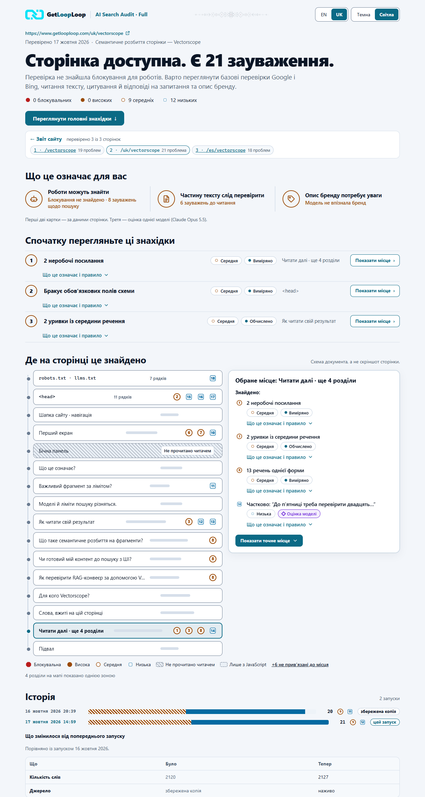
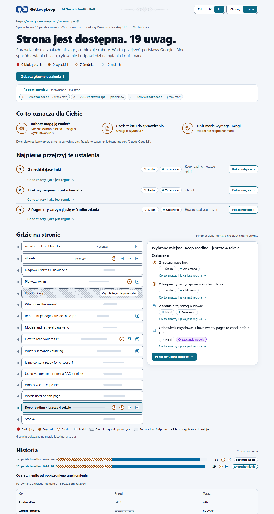

[English](README.md) · [Українська](README.uk.md) · Polski

# AI Search Audit Full

AI Search Audit Full **2.110** to skill (Agent Skill) od [GetLoopLoop](https://www.getlooploop.com) dla claude.ai i aplikacji Claude na komputer, Claude Code, Codex, opencode, Hermes Agent i innych agentów, które wczytują skille `SKILL.md`. Wersje liczy się w tysięcznych (2.101, 2.102, …).

Zanim Google, Bing albo asystent AI pokaże lub zacytuje stronę, robot musi zostać wpuszczony, strona musi powiedzieć, czym jest, a tekst musi przetrwać odczyt przez maszynę. `ai-search-audit-full` sprawdza publiczne strony według opublikowanych reguł dla wszystkich trzech warunków, dodaje trzy odczyty, które może zrobić tylko AI (pytania, jakie zadają ludzie, jak model agenta opisuje markę i co sądzi o jej opiniach), i objaśnia każdy znaleziony problem: co jest nie tak i dlaczego to ważne, co mówi reguła słowami samego źródła oraz, dla specjalistów, w którą stronę idzie poprawka. Audytuje jedną stronę albo do 50 stron serwisu, porównuje przebieg ze starszym i prowadzi lokalną historię, więc każdy raport pokazuje, co się zmieniło od poprzedniego przebiegu. Na dole każdego raportu strony blok *Na ile tekst brzmi jak wygenerowany* zestawia wskaźnik szablonowości, słowa nadużywane przez modele językowe i test podmiany przeprowadzony przez agenta. Raporty można czytać po angielsku, ukraińsku lub polsku.

To jest edycja Full. Opiera się na publicznej [Lite](https://github.com/Olexan-art/ai-search-audit) (2.109) i wykonuje wszystkie kontrole Lite.


## Co Full dodaje do Lite

| | Lite | Full |
|---|---|---|
| Każdy problem | krótka etykieta, waga, miejsce | do tego **Co jest nie tak**: prosty opis dla juniorów i menedżerów, bez porad |
| Reguła | tylko w eksporcie | **Co mówi reguła**: krótki dosłowny cytat z oficjalnego źródła z linkiem i datą sprawdzenia albo „Reguła tego skilla”, gdy nikt takiej nie publikuje (83 cytaty, każdy porównany słowo w słowo z aktualnymi stronami 17 października 2026) |
| Poprawki | brak | **kierunek poprawki**, techniczny i zwięzły, tylko w zwiniętych „Szczegółach dla specjalistów” każdego problemu |
| Strony | jedna | **do 50 na serwis**, z listy adresów lub z sitemapy, czytane pojedynczo z poszanowaniem robots.txt; limit jest podany jako sprawdzone / wszystkie, z każdą pominiętą stroną i powodem |
| Serwis | — | **raport serwisu**: strony × problemy, problemy powtarzające się na wielu stronach zgrupowane jako „na N stronach” oraz kontrole możliwe tylko na zestawie stron (powtórzone title, opisy i h1, strony osierocone, głębokość linków, pary hreflang, łańcuchy canonical, linki wewnętrzne przez przekierowania, zbyt krótkie strony) |
| Przed/po | — | `--compare old-export.json`: ustalenia naprawione, nowe i bez zmian dla każdej strony |
| Na ile tekst brzmi jak wygenerowany | ten sam blok | ten sam blok na każdej stronie serwisu, test podmiany z `style/<page>.json` |
| Historia | — | każdy przebieg zapisany jako migawka we własnym folderze użytkownika, którego nie zeruje ani nowy czat, ani nowy folder, ani nowa wersja skilla, i przenoszony wewnątrz każdego raportu; **oś czasu** każdej strony, **co się zmieniło od poprzedniego przebiegu** (title, opis, canonical, h1, liczba słów, typy schema, robots.txt i każdy bot, hreflang, fragmenty nowe, utracone i zmienione, problemy naprawione, nowe i bez zmian) oraz **wszystkie audyty w historii**, jeden wiersz na adres, dowolna strona i dowolny serwis |

W raporcie każde ustalenie w sekcji *Najpierw przejrzyj te ustalenia* i w wybranym miejscu rozwija się do prostego opisu i tego, co mówi reguła; historia oraz przed/po są pod sekcją *Gdzie na stronie*; kierunki poprawek leżą w szczegółach dla specjalistów każdego problemu, w sekcji *Wszystkie sprawdzenia i szczegóły techniczne*.

Wszystko zostaje lokalnie: bez serwera, bez wysyłania danych. Skrypty nie wywołują żadnego modelu; części z oceną pisze agent, który uruchamia skill, i są oznaczone jego modelem.

**Mapa odpowiedzi** zbiera pytania, które zadają ludzie, w jedną tabelę: czy strona odpowiada na każde z nich, jakość na 100 (stała suma: pełna lub częściowa odpowiedź, czy da się ją zacytować samodzielnie, czy otwiera swój fragment), czego brakuje i „dodać najpierw” przy trzech najsłabszych.


Na ile tekst brzmi jak wygenerowany, na dole każdego raportu strony: wskaźnik szablonowości, słowa-markery, test podmiany i każdy fragment z dowodami. To nie wykrywa autorstwa i blok mówi to wprost:


Raport serwisu, ta sama strona w ciemnym motywie, strona po ukraińsku i po polsku:






## Przykłady

Prawdziwe przebiegi w [`examples/`](examples): strony przeczytano 17 października 2026 i ponownie zaudytowano 18 października wersją 2.109, która dodała *Na ile tekst brzmi jak wygenerowany* (wynik 1, 2 i 0 na 100, żadnych słów-markerów, a ogólnikowych fragmentów 4 z 17, 4 z 17 i 5 z 18 na trzech stronach). Pliki z ocenami w [`examples/judgement/`](examples/judgement) napisał Claude Code z modelem Claude Opus 5.5, który nie znał GetLoopLoop z własnej wiedzy i sam to przyznał; nie wywołano żadnego modelu produktu.

- **Audyt trzech stron** getlooploop.com: [raport serwisu](examples/getlooploop-site/report/index.html) i jego strony, [/vectorscope](examples/getlooploop-site/report/pages/getlooploop-com-vectorscope.html) (19 problemów: 0 blokujących · 0 wysokich · 7 średnich · 12 niskich), [/uk/vectorscope](examples/getlooploop-site/report/pages/getlooploop-com-uk-vectorscope.html) (21: 0 · 0 · 8 · 13) i [/es/vectorscope](examples/getlooploop-site/report/pages/getlooploop-com-es-vectorscope.html) (18: 0 · 0 · 7 · 11). 15 problemów powtarza się na kilku stronach; w skali serwisu żadna zaudytowana strona nie linkuje do innej.
- **Dwie migawki historii dla każdej strony** w [`examples/history/`](examples/history), żeby zmiany było widać. Pierwszy przebieg /vectorscope i /uk/vectorscope przeczytał kopie tych stron zapisane 16 października 2026 ([`examples/first-run/`](examples/first-run), z kontrolami serwisu pobranymi na żywo, oznaczonymi „zapisana kopia”); drugi przeczytał je na żywo. Na każdej zmienił się jeden fragment, a raport pokazuje, gdzie. /es/vectorscope przeczytano na żywo dwa razy, w odstępie kilku minut: bez zmian.
- **Przed i po**: [/vectorscope w porównaniu z eksportem Lite 2.101](examples/compare/vectorscope-compare.html) tej samej strony, zrobionym wcześniej tego samego dnia: 0 naprawionych, 1 nowe (kontrola nagłówków bezpieczeństwa, którą dodała Lite 2.102), 18 bez zmian.

Raporty otwierają się po angielsku; dodaj `#lang=uk`, żeby czytać po ukraińsku, albo `#lang=pl`, żeby czytać po polsku.

## Instalacja

Skill wymaga Node 20.18 lub nowszego i **żadnego `npm install`**: `dist/read.mjs` i `dist/audit.mjs` zawierają wszystko, czego potrzebują.

### claude.ai i aplikacja Claude na komputer

1. Pobierz **`ai-search-audit-full.zip`** z [Releases](https://github.com/Olexan-art/ai-search-audit-full/releases) tego repozytorium albo poleceniem `gh release download v2.110 -R Olexan-art/ai-search-audit-full`. **Nie rozpakowuj go**: przesyłanie przyjmuje zip z folderem `ai-search-audit-full` na najwyższym poziomie.
2. Włącz wykonywanie kodu: **Settings > Capabilities > Code execution and file creation**. W planach Team i Enterprise decyduje o tym właściciel w Organization settings > Capabilities.
3. Prześlij skill: **Customize > Skills**, **+**, **Create skill**, **Upload a skill**, wybierz `ai-search-audit-full.zip` i włącz skill.
4. Pozwól piaskownicy łączyć się z serwisem: **Allow network egress** (Free, Pro, Max) albo lista domen ustawiona przez właściciela w Team i Enterprise. Audyt serwisu wysyła te same zapytania co audyt strony, dla każdej strony.
5. Poproś: **„audyt AI search dla https://example.com/page”** albo **„zaudytuj te strony mojego serwisu: …”**. Claude uruchomi skrypty i przekaże ci `report.html` (dla serwisu folder raportu jako zip, z `index.html` jako stroną startową).

Lite i Full mają różne nazwy (`ai-search-audit`, `ai-search-audit-full`), więc można zainstalować oba obok siebie.

### Claude Code, Codex, opencode, Hermes Agent

```
gh repo clone Olexan-art/ai-search-audit-full
```

Skopiuj `skills/ai-search-audit-full` do folderu skilli swojego agenta:

| Agent | Osobiście | W projekcie |
|---|---|---|
| Claude Code | `~/.claude/skills/ai-search-audit-full` | `.claude/skills/ai-search-audit-full` |
| Codex | `~/.agents/skills/ai-search-audit-full` | `.agents/skills/ai-search-audit-full` |
| opencode | `~/.config/opencode/skills/ai-search-audit-full` (albo foldery Claude lub Codex) | `.opencode/skills/ai-search-audit-full` |
| Hermes Agent | `~/.hermes/skills/ai-search-audit-full` | `.hermes/skills/` po `hermes skills trust` |

```
mkdir -p ~/.claude/skills && cp -r ai-search-audit-full/skills/ai-search-audit-full ~/.claude/skills/
```

```powershell
New-Item -ItemType Directory -Force "$HOME\.claude\skills" | Out-Null
Copy-Item -Recurse ai-search-audit-full\skills\ai-search-audit-full "$HOME\.claude\skills\ai-search-audit-full"
```

**Każdy inny agent:** wskaż skill w jego pliku z instrukcjami (na przykład `AGENTS.md`):

```
For an SEO or AI search audit of a web page or a site, follow skills/ai-search-audit-full/SKILL.md and run its scripts from that folder.
```

**GLM** i inne rodziny modeli działają wewnątrz jednego z tych agentów; zainstaluj skill dla tego agenta.

Źródła: [Use skills in Claude](https://support.claude.com/en/articles/12512180-use-skills-in-claude) · [Claude Code skills](https://code.claude.com/docs/en/skills) · [Codex skills](https://learn.chatgpt.com/docs/build-skills) · [opencode skills](https://opencode.ai/docs/skills) · [Hermes Agent skills](https://hermes-agent.nousresearch.com/docs/user-guide/features/skills). Sprawdzono 2026-10-16.

### Agent bez internetu w powłoce

Chmurowe piaskownice często uruchamiają powłokę bez sieci albo nie pozwalają pisać do folderu skilli. Skill nie potrzebuje folderu skilli: rozpakuj `ai-search-audit-full.zip` w dowolnym miejscu, do którego agent może pisać, i wskaż mu ten folder (albo dołącz zip do czatu). Bez sieci zapisz stronę w przeglądarce jako „Strona internetowa, tylko HTML” i, jeśli możesz, jej `robots.txt`, a potem przekaż oba pliki agentowi: skill przeczyta zapisaną kopię i oznaczy każdą kontrolę wymagającą sieci jako niesprawdzoną.

## Przebieg w skrócie

Jedna strona:

```
node dist/read.mjs https://example.com/page --out reading.json
# agent pisze questions.json, style.json, brand.json i reviews.json (schematy w SKILL.md)
node dist/audit.mjs reading.json --questions questions.json --style style.json --brand brand.json --reviews reviews.json --check
node dist/audit.mjs reading.json --questions questions.json --style style.json --brand brand.json --reviews reviews.json --html report.html --md report.md --json export.json [--compare old-export.json]
```

Serwis (najwyżej 50 stron):

```
node dist/read.mjs --urls urls.txt --out-dir readings          # albo: --sitemap https://example.com/sitemap.xml
# agent pisze questions/<page>.json i style/<page>.json dla każdej strony, a brand.json i reviews.json raz
node dist/audit.mjs --site readings/site.json --questions-dir questions --style-dir style --brand brand.json --reviews reviews.json --out-dir report
```

**Uprzejmość:** strony są czytane pojedynczo, co najmniej co 1 sekundę (`--delay`, nigdy poniżej 500 ms), dłużej, gdy robots.txt ustawia `Crawl-delay` (do 10 s), i tylko tam, gdzie robots.txt pozwala pobierać `GetLoopLoop` (w przeciwnym razie `*`); jeśli robots.txt nie odpowiada, żadna strona tego serwisu nie zostanie przeczytana. Zapytania powtarzające się między stronami (robots.txt, sitemapa, wspólne linki) są obsługiwane z pamięci.

**Historia:** każdy przebieg `audit.mjs` zapisuje swój eksport w `~/.ai-search-audit/history/<host>/<path>/<date>.json` (albo w `$AI_SEARCH_AUDIT_HISTORY`; `--history dir` dla innego folderu, `--no-history`, by nic nie zapisywać). Folder należy do użytkownika, nie do skilla, więc aktualizacja skilla go nie rusza; folder, który starsza wersja zostawiła w katalogu roboczym, zostanie skopiowany. Każdy raport niesie też całą historię, więc tam, gdzie dysk czatu nie przetrwa (claude.ai, nowa piaskownica Cowork), kolejny przebieg odzyskuje ją z wcześniejszego raportu: `--history-from report.html` (albo folder z raportami, eksportami lub `site.json`), niezależnie od tego, jakiej strony czy serwisu dotyczył. Ponowny audyt tego samego odczytu nadpisuje jego migawkę. Usuń folder, żeby usunąć historię.

### Własne progi tego skilla

Progi Lite obowiązują bez zmian; są wymienione w [README Lite](https://github.com/Olexan-art/ai-search-audit#this-skills-own-thresholds). Full dodaje dla serwisu: najwyżej 50 stron; strona dalej niż 3 kliknięcia od strony głównej w obrębie audytowanego zestawu; strona poniżej 30% mediany liczby słów audytowanych stron, od 4 stron; kontrole grafu linków od 3 stron; ostatnie 20 przebiegów na osi czasu; do 8 fragmentów wymienionych w każdą stronę w zmianach. Każdy próg to nazwana stała w `skills/ai-search-audit-full/scripts/lib/`.

## Czego nie widzi

- **Danych z terenu i indeksu:** Core Web Vitals i „w indeksie Google” są zawsze *niezmierzone*.
- **Tego, co asystenci odpowiadają dziś:** odczyty marki i opinii to wiedza jednego modelu, a nie pomiar żadnego asystenta.
- **Stron za logowaniem, adresów lokalnych i prywatnych.**
- **Całych serwisów:** najwyżej 50 stron; kontrole na poziomie serwisu widzą tylko audytowane strony (strona osierocona tutaj może mieć link ze strony spoza zestawu).
- **JavaScriptu, chyba że się o to poprosi** (`--render` albo automatycznie dla pustej powłoki aplikacji, z lokalnym Chrome).
- **Niczego poza limitami:** każdy limit jest nazwany w raporcie.

Żywi asystenci, zmienność odpowiedzi, embeddingi i Search Console: zobacz [GetLoopLoop](https://www.getlooploop.com).

## Praca nad skillem

```
cd skills/ai-search-audit-full
npm install          # cheerio oraz esbuild do budowania
npm run build        # scripts/ → dist/
npm test             # 227 testów, w tym czy dist jest równy świeżemu buildowi
npm run verify-rules # sieć: każdy cytat reguły porównany z jego aktualną stroną
npm run zip          # dist-release/ai-search-audit-full.zip
```

Aby przyjąć nowe wydanie Lite: nałóż diff Lite od poprzedniego wydania na `skills/ai-search-audit-full` (folder ma zmienioną nazwę), a potem napisz objaśnienia dla nowych kodów; `tests/explain.test.mjs` nie przejdzie, dopóki każdy kod ich nie ma.

## Licencja

MIT, jak Lite: zobacz [LICENSE](LICENSE). Dołączony kod Vectorscope zachowuje swoją licencję MIT ([`scripts/vendor/vectorscope/LICENSE`](skills/ai-search-audit-full/scripts/vendor/vectorscope/LICENSE)), a favikony swoją [informację](skills/ai-search-audit-full/assets/favicons/NOTICE.txt).
