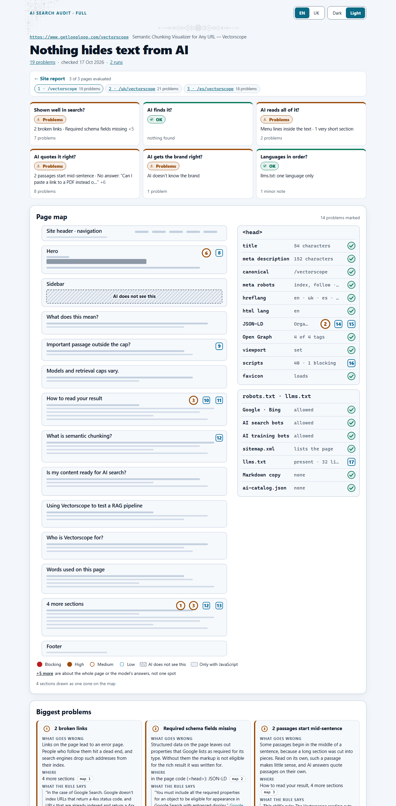
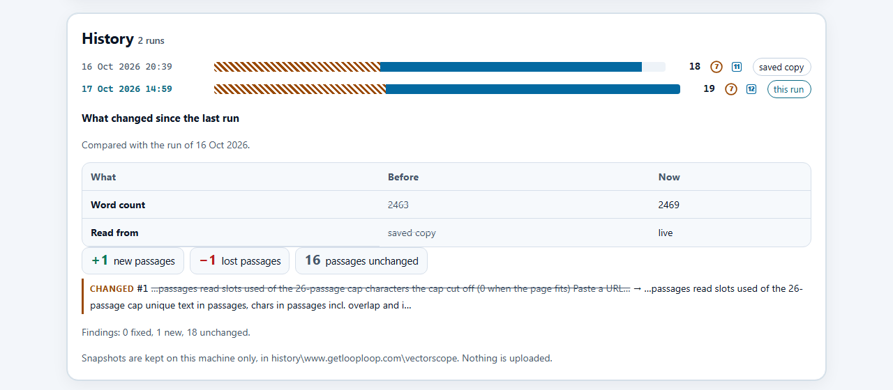
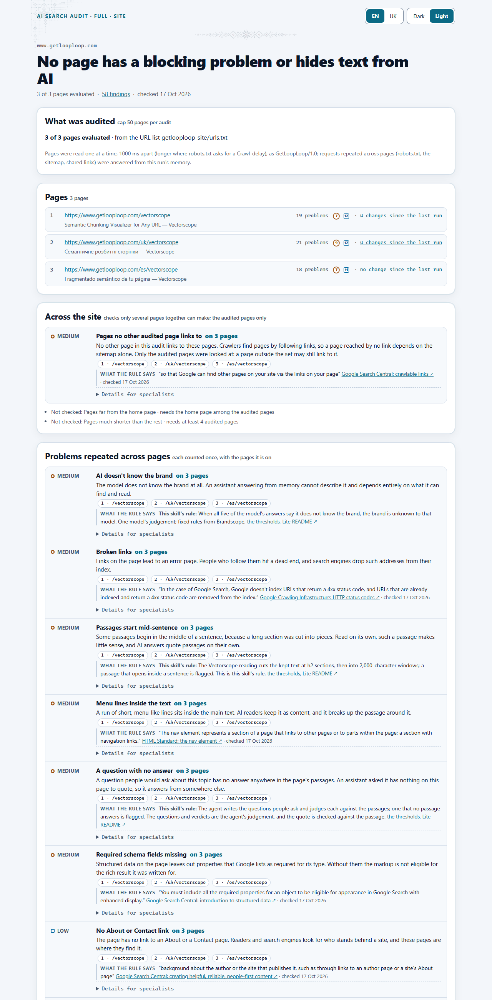
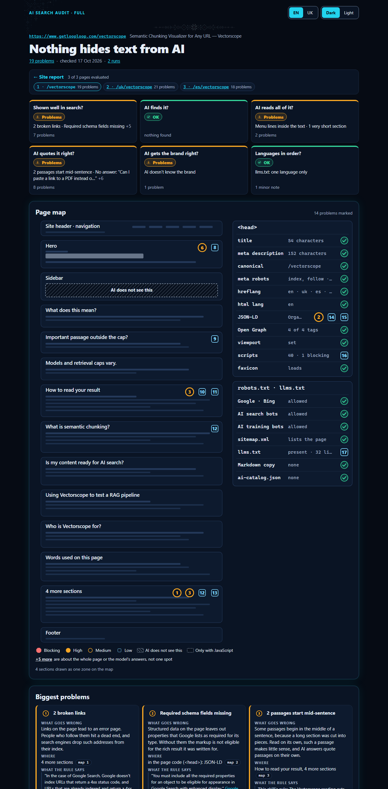
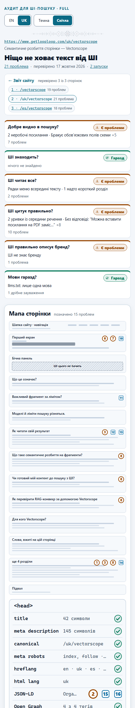

[English](README.md) · Українська

# AI Search Audit Full

AI Search Audit Full **2.101** — навичка (Agent Skill) від [GetLoopLoop](https://www.getlooploop.com) для claude.ai і застосунку Claude, Claude Code, Codex, opencode, Hermes Agent та інших агентів, що завантажують навички `SKILL.md`. Версії рахуються в тисячних (2.101, 2.102, …).

Перш ніж Google, Bing чи ШІ-асистент покажуть або процитують сторінку, краулер має отримати дозвіл, сторінка має сказати, що вона таке, а текст має пережити машинне читання. `ai-search-audit-full` перевіряє публічні сторінки за опублікованими правилами для всіх трьох, додає три прочитання, які може зробити лише ШІ (запитання людей, як модель агента описує бренд і що вона вважає про його відгуки), і пояснює кожну знайдену проблему: що не так і чому це важливо, що каже правило словами самого джерела і, для фахівців, у який бік іде виправлення. Навичка перевіряє одну сторінку або до 50 сторінок сайту, порівнює запуск зі старішим і зберігає локальну історію, тож кожен звіт показує, що змінилося від попереднього запуску.

Це приватна версія Full. Вона побудована на публічній [Lite](https://github.com/Olexan-art/ai-search-audit) (2.102) і виконує всі перевірки Lite.



## Що Full додає до Lite

| | Lite | Full |
|---|---|---|
| Кожна проблема | коротка назва, серйозність, місце | плюс **Що не так**: простий опис для джунів і менеджерів, без порад |
| Правило | лише в експорті | **Що каже правило**: коротка дослівна цитата з офіційного джерела з посиланням і датою перевірки або «Правило цієї навички», де ніхто такого не публікує (83 цитати, кожну звірено слово в слово з живими сторінками 17 жовтня 2026) |
| Виправлення | немає | **напрям виправлення**, технічний і стислий, лише в згорнутих «Подробицях для фахівців» кожної проблеми |
| Сторінки | одна | **до 50 на сайт**, зі списку адрес або sitemap, по одній і з дотриманням robots.txt; ліміт показано як «перевірено / знайдено», з кожною пропущеною сторінкою й причиною |
| Сайт | — | **звіт сайту**: сторінки × проблеми, проблеми, що повторюються, згруповані як «на N сторінках», і перевірки, можливі лише на наборі сторінок (однакові title, описи й h1, сторінки-сироти, глибина посилань, пари hreflang, ланцюжки canonical, внутрішні посилання через переадресацію, надто короткі сторінки) |
| До і після | — | `--compare old-export.json`: виправлені, нові й незмінні знахідки для кожної сторінки |
| Історія | — | кожен запуск зберігається знімком на цьому комп’ютері; **часова шкала** кожної сторінки і **що змінилося від попереднього запуску** (title, опис, canonical, h1, кількість слів, типи схеми, robots.txt і кожен бот, hreflang, уривки нові, втрачені й змінені) |

Усе лишається локальним: жодного сервера, жодного вивантаження. Скрипти не викликають жодної моделі; частини із судженнями пише агент, що виконує навичку, і вони позначені його моделлю.



Звіт сайту, та сама сторінка в темній темі й сторінка українською на вузькому екрані:



 

## Приклади

Справжні запуски в [`examples/`](examples) (17 жовтня 2026). Файли суджень у [`examples/judgement/`](examples/judgement) написав Claude Code з моделлю Claude Opus 5.5, яка не знала GetLoopLoop із власних знань і так і сказала; жодної моделі продукту не викликали.

- **Аудит трьох сторінок** getlooploop.com: [звіт сайту](examples/getlooploop-site/report/index.html) і його сторінки, [/vectorscope](examples/getlooploop-site/report/pages/getlooploop-com-vectorscope.html) (19 проблем: 0 блокувальних · 0 високих · 7 середніх · 12 низьких), [/uk/vectorscope](examples/getlooploop-site/report/pages/getlooploop-com-uk-vectorscope.html) (21: 0 · 0 · 9 · 12) і [/es/vectorscope](examples/getlooploop-site/report/pages/getlooploop-com-es-vectorscope.html) (18: 0 · 0 · 7 · 11). 15 проблем повторюються на сторінках; на рівні сайту жодна перевірена сторінка не посилається на іншу.
- **Два знімки історії для кожної сторінки** в [`examples/history/`](examples/history), тож зміни видно. Перший запуск /vectorscope і /uk/vectorscope прочитав копії цих сторінок, збережені 16 жовтня 2026 ([`examples/first-run/`](examples/first-run), з перевірками сайту наживо, позначено «збережена копія»); другий прочитав їх наживо. На кожній змінився один уривок, і звіт показує, де саме. /es/vectorscope прочитано наживо двічі з різницею в кілька хвилин: без змін.
- **До і після**: [/vectorscope проти експорту Lite 2.101](examples/compare/vectorscope-compare.html) тієї самої сторінки, зробленого раніше того самого дня: виправлено 0, нова 1 (перевірка заголовків безпеки, яку додала Lite 2.102), без змін 18.

Звіти відкриваються англійською; додайте `#lang=uk` для української.

## Встановлення

Потрібен Node 20.18 або новіший і **жодного `npm install`**: `dist/read.mjs` і `dist/audit.mjs` уже містять усе потрібне. Репозиторій і реліз приватні: потрібен доступ до [Olexan-art/ai-search-audit-full](https://github.com/Olexan-art/ai-search-audit-full).

### claude.ai і застосунок Claude

1. Завантажте **`ai-search-audit-full.zip`** з [Releases](https://github.com/Olexan-art/ai-search-audit-full/releases) цього репозиторію (увійшовши з доступом) або `gh release download v2.101 -R Olexan-art/ai-search-audit-full`. **Не розпаковуйте**: завантаження приймає zip із текою `ai-search-audit-full` на верхньому рівні.
2. Увімкніть виконання коду: **Settings > Capabilities > Code execution and file creation**. На планах Team і Enterprise це вмикає власник в Organization settings > Capabilities.
3. Завантажте навичку: **Customize > Skills**, **+**, **Create skill**, **Upload a skill**, оберіть `ai-search-audit-full.zip` і ввімкніть навичку.
4. Дозвольте пісочниці доступ до сайту: **Allow network egress** (Free, Pro, Max) або список доменів власника на Team і Enterprise. Аудит сайту робить ті самі запити, що й аудит сторінки, для кожної сторінки.
5. Попросіть: **«аудит для ШІ-пошуку https://example.com/page»** або **«перевір ці сторінки мого сайту: …»**. Claude виконає скрипти й дасть вам `report.html` (для сайту — теку звіту zip-архівом, де початок — `index.html`).

Lite і Full мають різні назви (`ai-search-audit`, `ai-search-audit-full`), тож їх можна встановити поруч.

### Claude Code, Codex, opencode, Hermes Agent

```
gh repo clone Olexan-art/ai-search-audit-full
```

Скопіюйте `skills/ai-search-audit-full` у теку навичок свого агента:

| Агент | Особисто | Для проєкту |
|---|---|---|
| Claude Code | `~/.claude/skills/ai-search-audit-full` | `.claude/skills/ai-search-audit-full` |
| Codex | `~/.agents/skills/ai-search-audit-full` | `.agents/skills/ai-search-audit-full` |
| opencode | `~/.config/opencode/skills/ai-search-audit-full` (або теки Claude чи Codex) | `.opencode/skills/ai-search-audit-full` |
| Hermes Agent | `~/.hermes/skills/ai-search-audit-full` | `.hermes/skills/` після `hermes skills trust` |

```
mkdir -p ~/.claude/skills && cp -r ai-search-audit-full/skills/ai-search-audit-full ~/.claude/skills/
```

```powershell
New-Item -ItemType Directory -Force "$HOME\.claude\skills" | Out-Null
Copy-Item -Recurse ai-search-audit-full\skills\ai-search-audit-full "$HOME\.claude\skills\ai-search-audit-full"
```

**Будь-який інший агент:** вкажіть у його файлі інструкцій (наприклад, `AGENTS.md`) на навичку:

```
For an SEO or AI search audit of a web page or a site, follow skills/ai-search-audit-full/SKILL.md and run its scripts from that folder.
```

**GLM** та інші сімейства моделей працюють усередині одного з цих агентів; встановлюйте навичку для того агента.

Джерела: [Use skills in Claude](https://support.claude.com/en/articles/12512180-use-skills-in-claude) · [Claude Code skills](https://code.claude.com/docs/en/skills) · [Codex skills](https://learn.chatgpt.com/docs/build-skills) · [opencode skills](https://opencode.ai/docs/skills) · [Hermes Agent skills](https://hermes-agent.nousresearch.com/docs/user-guide/features/skills). Перевірено 2026-10-16.

## Запуск коротко

Одна сторінка:

```
node dist/read.mjs https://example.com/page --out reading.json
# агент пише questions.json, brand.json і reviews.json (схеми в SKILL.md)
node dist/audit.mjs reading.json --questions questions.json --brand brand.json --reviews reviews.json --check
node dist/audit.mjs reading.json --questions questions.json --brand brand.json --reviews reviews.json --html report.html --md report.md --json export.json [--compare old-export.json]
```

Сайт (щонайбільше 50 сторінок):

```
node dist/read.mjs --urls urls.txt --out-dir readings          # або: --sitemap https://example.com/sitemap.xml
# агент пише questions/<сторінка>.json для кожної сторінки, а brand.json і reviews.json один раз
node dist/audit.mjs --site readings/site.json --questions-dir questions --brand brand.json --reviews reviews.json --out-dir report
```

**Ввічливість:** сторінки читаються по одній, щонайменше з секундною паузою (`--delay`, не менше 500 мс), довшою, коли robots.txt задає `Crawl-delay` (до 10 с), і лише там, де robots.txt дозволяє `GetLoopLoop` (інакше `*`); якщо robots.txt не відповідає, жодна сторінка цього сайту не читається. Запити, що повторюються між сторінками (robots.txt, sitemap, спільні посилання), беруться з пам’яті.

**Історія:** кожен запуск `audit.mjs` зберігає експорт у `./.ai-search-audit/history/<хост>/<шлях>/<дата>.json` (`--history тека` або `--no-history`). Повторний аудит того самого читання перезаписує його знімок. Видаліть теку, щоб видалити історію.

### Власні пороги навички

Пороги Lite діють без змін; їх перелічено в [README Lite](https://github.com/Olexan-art/ai-search-audit#this-skills-own-thresholds). Full додає для сайту: щонайбільше 50 сторінок; сторінка, що за понад 3 кліки від головної в межах перевіреного набору; сторінка, що має менше ніж 30% від медіанної кількості слів перевірених сторінок, від 4 сторінок; перевірки графа посилань від 3 сторінок; останні 20 запусків на часовій шкалі; до 8 уривків у кожен бік у змінах. Кожен поріг — іменована константа в `skills/ai-search-audit-full/scripts/lib/`.

## Чого перевірка не бачить

- **Польових даних та індексу:** Core Web Vitals і «в індексі Google» завжди *не виміряно*.
- **Що асистенти відповідають сьогодні:** прочитання бренду й відгуків — знання однієї моделі, а не вимірювання жодного асистента.
- **Сторінок за логіном, локальних і приватних адрес.**
- **Цілих сайтів:** щонайбільше 50 сторінок; перевірки на рівні сайту бачать лише перевірені сторінки (сторінка-сирота тут може мати посилання зі сторінки поза набором).
- **JavaScript, якщо не попросити** (`--render` або автоматично для порожньої оболонки застосунку, з локальним Chrome).
- **Усього за лімітами:** кожен ліміт названо у звіті.

Живі асистенти, мінливість відповідей, ембединги й Search Console — на [GetLoopLoop](https://www.getlooploop.com).

## Робота над навичкою

```
cd skills/ai-search-audit-full
npm install          # cheerio і esbuild для збирання
npm run build        # scripts/ → dist/
npm test             # 220 тестів, зокрема що dist дорівнює свіжому збиранню
npm run verify-rules # мережа: кожну цитату правила звірено з живою сторінкою
npm run zip          # dist-release/ai-search-audit-full.zip
```

Щоб узяти новий реліз Lite: застосуйте diff Lite від попереднього на `skills/ai-search-audit-full` (тека перейменована), потім напишіть пояснення для нових кодів; `tests/explain.test.mjs` не пройде, доки їх немає для кожного коду.

## Ліцензія

Пропрієтарна: Copyright (c) 2026 Olexandr Tsyrkin. All rights reserved. Див. [LICENSE](LICENSE). Вендорений код Vectorscope зберігає свою ліцензію MIT ([`scripts/vendor/vectorscope/LICENSE`](skills/ai-search-audit-full/scripts/vendor/vectorscope/LICENSE)), а favicon — своє [повідомлення](skills/ai-search-audit-full/assets/favicons/NOTICE.txt).
